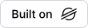
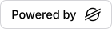

# community-stellar-badge

[](https://stellar.org)

A "Built on Stellar" badge with the official Stellar logo and the Inter typeface. It is a static SVG served from a CDN, plus an optional script tag. There is no server.

| Built on                                                             | Powered by                                                               |
| -------------------------------------------------------------------- | ------------------------------------------------------------------------ |
|    |    |
|  |  |

The text is converted to SVG paths at build time. An SVG inside `` cannot load fonts, so real text would fall back to a serif. With paths the badge looks identical everywhere and makes no font requests.

## Usage

### README

```md
[](https://stellar.org)
```

`auto` follows the viewer's light or dark color scheme.

### README that follows GitHub's own theme

```html
<a href="https://stellar.org">
  <picture>
    <source
      media="(prefers-color-scheme: dark)"
      srcset="https://cdn.jsdelivr.net/npm/community-stellar-badge@1/badges/dark.svg"
    />
    
  </picture>
</a>
```

### Website

```html
<script
  src="https://cdn.jsdelivr.net/npm/community-stellar-badge@1/dist/embed.js"
  data-theme="dark"
></script>
```

The script reads `data-label`, `data-theme` and `data-size` from its own tag and inserts a link to stellar.org holding the inline SVG.

### Code

```ts
import { render } from "community-stellar-badge";

const svg = render({ label: "powered-by", theme: "dark", size: "lg" });
```

## Options

| Option  | Values                          | Default    |
| ------- | ------------------------------- | ---------- |
| `label` | `built-on`, `powered-by`        | `built-on` |
| `theme` | `dark`, `light`, `auto`         | `auto`     |
| `size`  | `sm` 20px, `md` 28px, `lg` 36px | `md`       |

Invalid options fall back to the defaults, and `render()` never throws. There is no logo color option, because the Stellar Development Foundation's brand policy forbids altering the logo. There is no raw font size either, because the text and logo must scale together.

### Static files

Every preset is a file at `badges/{label}-{theme}-{size}.svg`, for example:

```
https://cdn.jsdelivr.net/npm/community-stellar-badge@1/badges/powered-by-dark-lg.svg
```

Three shortcuts use the defaults for the label and size: `badges/dark.svg`, `badges/light.svg` and `badges/auto.svg`.

`@1` always points at the latest 1.x release, so fixes reach every README with no change to your snippet.

## Disclaimer

Place this near the badge, or on a credits page:

> This is independent software, not affiliated with, sponsored or endorsed by the Stellar Development Foundation.

Every badge also carries it in its `<title>`.

"Stellar" is a trademark of the Stellar Development Foundation. This is an independent community project, not affiliated with, sponsored or endorsed by the Stellar Development Foundation.

## Contributing

See [CONTRIBUTING.md](CONTRIBUTING.md).

## License

MIT
