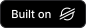
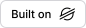

# community-stellar-badge

[](https://stellar.org)

A "Built on Stellar" badge with the official Stellar logo and the Inter typeface. It is a static SVG served from a CDN, plus an optional script tag and a small `render()` function. There is no server and nothing to install for the common case.

| Theme   | Preview                                                              |
| ------- | -------------------------------------------------------------------- |
| `dark`  |    |
| `light` |  |

`dark` is white and is meant for dark backgrounds. `light` is black and is meant for light backgrounds. One of the previews above will be hard to see on your current GitHub theme, which is why you pick the one that matches your background, or use `auto`.

## Quick start

Paste this into your README. It follows the viewer's light or dark mode and links to stellar.org.

```md
[](https://stellar.org)
```

Then add the [disclaimer](#disclaimer) somewhere near it.

## The three badges

| File               | Use it for                                         |
| ------------------ | -------------------------------------------------- |
| `badges/auto.svg`  | Anywhere. Switches with the viewer's color scheme. |
| `badges/dark.svg`  | Dark backgrounds. White text and logo.             |
| `badges/light.svg` | Light backgrounds. Black text and logo.            |

Full URLs:

```
https://cdn.jsdelivr.net/npm/community-stellar-badge@1/badges/auto.svg
https://cdn.jsdelivr.net/npm/community-stellar-badge@1/badges/dark.svg
https://cdn.jsdelivr.net/npm/community-stellar-badge@1/badges/light.svg
```

Each file is one request of about 3 KB gzipped. The text is converted to SVG paths at build time, so the badge makes no font requests and looks identical everywhere, including inside `` tags where an SVG cannot load fonts.

## Usage

### Markdown (GitHub README, docs)

```md
[](https://stellar.org)
```

### README that follows GitHub's own theme

GitHub's light and dark mode is a site setting, not always the OS setting, so `auto` can pick the wrong one there. Use `<picture>` to match GitHub's theme exactly:

```html
<a href="https://stellar.org">
  <picture>
    <source
      media="(prefers-color-scheme: dark)"
      srcset="https://cdn.jsdelivr.net/npm/community-stellar-badge@1/badges/dark.svg"
    />
    
  </picture>
</a>
```

### HTML

```html
<a href="https://stellar.org">
  
</a>
```

The badge is 28px tall by default. It is a vector, so you can set any `height` (or `width`) on the `` and it stays sharp.

### Script tag

For a website, one script tag inserts the badge as a link to stellar.org. It appears exactly where you place the tag.

```html
<script src="https://cdn.jsdelivr.net/npm/community-stellar-badge@1/dist/embed.js"></script>
```

Configure it with data attributes:

```html
<script
  src="https://cdn.jsdelivr.net/npm/community-stellar-badge@1/dist/embed.js"
  data-label="powered-by"
  data-theme="dark"
  data-size="lg"
></script>
```

### JavaScript or TypeScript

```sh
npm install community-stellar-badge
```

```ts
import { render } from "community-stellar-badge";

const svg = render({ label: "powered-by", theme: "dark", size: "lg" });
```

`render()` returns an SVG string. It is synchronous, takes a few microseconds, and has no runtime dependencies.

## Options

The script tag and `render()` accept these. The static files above use the defaults.

| Option  | Values                          | Default    |
| ------- | ------------------------------- | ---------- |
| `label` | `built-on`, `powered-by`        | `built-on` |
| `theme` | `dark`, `light`, `auto`         | `auto`     |
| `size`  | `sm` 20px, `md` 28px, `lg` 36px | `md`       |

- `label` chooses between "Built on Stellar" and "Powered by Stellar".
- `size` is the height of the badge. The text and logo always scale together.
- Anything invalid falls back to the default, and `render()` never throws.
- There is no logo color option, because the Stellar Development Foundation's brand policy forbids altering the logo.

In the script tag, the same options are `data-label`, `data-theme` and `data-size`.

## Versions and caching

`@1` always points at the latest 1.x release, so fixes reach every README with no change to your snippet. Pin an exact version for the most aggressive caching and fully stable output:

```
https://cdn.jsdelivr.net/npm/community-stellar-badge@1.0.0/badges/auto.svg
```

Releases follow semver. Patches never change how a badge looks, minors can tweak visuals or add options, and only a major release can rename or remove a file or option.

## Disclaimer

Place this near the badge, or on a credits page:

> This is independent software, not affiliated with, sponsored or endorsed by the Stellar Development Foundation.

Every badge also carries it in its SVG `<title>`.

"Stellar" is a trademark of the Stellar Development Foundation. This is an independent community project, not affiliated with, sponsored or endorsed by the Stellar Development Foundation.

## Contributing

See [CONTRIBUTING.md](CONTRIBUTING.md).

## License

MIT
